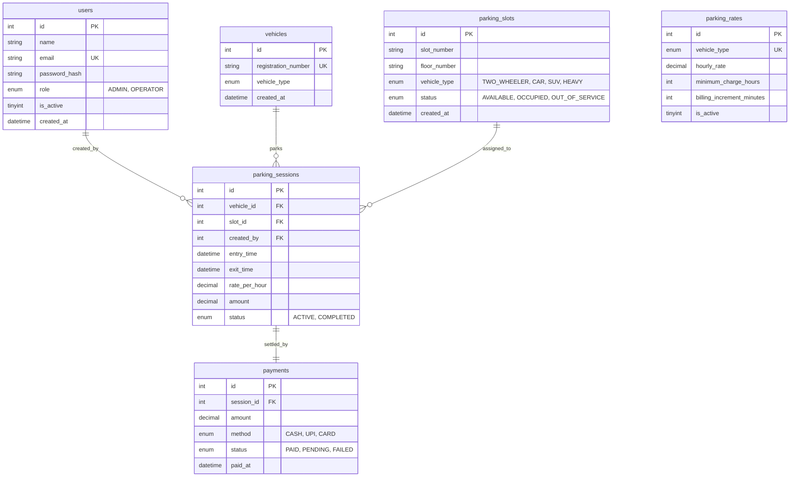

# SmartPark — Vehicle Parking Management System (Node.js, Express & MySQL)

A modern, responsive, and production-ready **Vehicle Parking Management System** built with **Node.js**, **Express.js**, **MySQL**, **EJS**, and **Bootstrap 5**.

The system features real-time Indian vehicle plate validation (Standard RTO & Bharat Series), ACID-transaction safe slot allocation, UPI QR code billing simulation (Google Pay, PhonePe, Paytm, BHIM), thermal printable tickets and tax invoices, role-based access control (Admin & Operator), and an interactive **1-Click Recruiter Demo Showcase**.

---

## 🌟 Recruiter & Portfolio Live Demo Mode

When you open the login page (`/login`), you have instant 1-click access buttons without typing credentials:

- 🟢 **1-Click Admin Demo**: Auto-logs in as **Rishabh Pal (Admin)** — Full access to dashboard analytics, parking tariff configuration, financial audits, and slot management.
- 🔵 **1-Click Operator Demo**: Auto-logs in as **Muskan Sharma (Operator)** — Day-to-day desk operations: inbound vehicle entry, ticket issuance, and exit checkout.
- 🔄 **Persona Switcher**: A sticky demo pill at the top allows instant switching between Admin and Operator personas.
- 🔑 **Manual Demo Credentials**:
  - **Admin**: `rishabh@gmail.com` | Password: `Rishabh@2218`
  - **Operator**: `muskan@gmail.com` | Password: `operator123`

---

## ⚡ Quick Start Guide (Local Setup)

### Prerequisites
- **Node.js** (v18+ recommended; tested on v26+)
- **MySQL Server** (MySQL 8.0+ or MariaDB 10.4+)

### Step 1: Clone & Install Dependencies
```bash
git clone https://github.com/rishabhpbca2024-afk/Vehicle-Parking-System.git
cd Vehicle-Parking-System
npm install
```

### Step 2: Configure Environment (`.env`)
Create or verify your `.env` file in the project root:
```env
# Database Connection Settings
DATABASE_URL="mysql://root@127.0.0.1:3306/parking_management"
DB_PASSWORD="your_mysql_password"

# Server & Session Settings
PORT=8000
SESSION_SECRET="smartpark_super_secret_key_2026"
APP_NAME="SmartPark - Parking Management System"
APP_ENV="development"
APP_TIMEZONE="Asia/Kolkata"

# Currency Configuration
APP_CURRENCY_SYMBOL="₹"
APP_CURRENCY_CODE="INR"
```

### Step 3: Run the Application
You can run the server in **one of two convenient ways**:

#### Method A: Via npm
```bash
npm start
```

#### Method B: Via 1-Click Batch Script (Windows)
Double-click **`start_server.bat`** (or `start_node.bat`).

Open your web browser and navigate to:  
👉 **[http://127.0.0.1:8000](http://127.0.0.1:8000)**

---

## 🌟 Core System Features

1. **Indian Vehicle Plate Validation (`utils/plateValidator.js`)**:
   - Live regex checks with real-time green/red UI feedback.
   - Enforces valid 2-letter Indian State & UT codes (`MH`, `DL`, `UP`, `KA`, `HR`, `RJ`, `GJ`, `MP`, etc.).
   - Full support for modern **Bharat (BH) Series** (e.g. `22 BH 1234 AA`).
   - Rejects illegal special characters, 00 RTO codes, and `0000` numbers.

2. **ACID Transaction-Safe Slot Allocation (`routes/vehicles.js`)**:
   - Uses MySQL row-level exclusive locks (`FOR UPDATE`) within database transactions.
   - Prevents race conditions when two operators simultaneously assign the same parking bay.
   - Supports auto-allocation of the nearest matching slot or manual bay selection.

3. **Interactive UPI Checkout Modal (`views/vehicles/checkout.ejs`)**:
   - Dedicated counter modal with official UPI QR code (Google Pay, PhonePe, Paytm, etc.).
   - Live 3-minute payment countdown timer.
   - Includes **"Auto-Detect / Simulate Scan (Demo)"** button for instant recruiter demonstrations.

4. **Thermal Printable Tickets & Official Tax Receipts**:
   - Simulated barcode and printable CSS formatted for 80mm/58mm thermal printers or A4 paper.
   - Dynamic issuer attribution: `Issued by Admin: Rishabh Pal` or `Issued by Operator: Muskan Sharma`.
   - Embedded QR code on invoice receipts for verification.

5. **Universal Light & Dark Mode Contrast Engine (`assets/css/style.css`)**:
   - Zero missing or faded text across both dark slate and clean light themes.
   - Instant theme toggle persisted in `localStorage`.

6. **Financial & Operational Audits (`routes/reports.js`)**:
   - Daily reports with breakdown by vehicle category and payment instrument (`CASH`, `UPI`, `CARD`).
   - Month-by-month financial progression matrix and interactive Chart.js bar graphs.

---

## 🛠️ Technology Stack

| Layer | Technology |
| :--- | :--- |
| **Runtime** | Node.js (ES6+ / CommonJS) |
| **Framework** | Express.js 5 |
| **Database** | MySQL 8.0+ (InnoDB Engine with Foreign Keys & Indexes) |
| **Database Driver** | `mysql2` (Connection Pooling & Prepared Statements) |
| **Template Engine** | EJS (Embedded JavaScript) |
| **Security & Auth** | `bcryptjs` (Blowfish Hashing), `express-session`, `connect-flash` |
| **Frontend Styling** | Bootstrap 5.3.3, Bootstrap Icons 1.11.3, Custom Slate Theme |
| **Data Visualizations** | Chart.js 4.4.2 |

---

## 📁 Project Architecture & Directory Structure

```text
Vechile_MS/
├── app.js                    # Express application entry point & route mounter
├── package.json              # Node.js dependencies & scripts
├── start_server.bat          # 1-Click launcher script (Node.js & browser)
├── start_node.bat            # Dedicated Node.js batch launcher
├── .env                      # Environment & database credentials
├── .gitignore                # Ignores node_modules, temp files, and secrets
├── README.md                 # Complete documentation & developer guide
├── config/
│   └── db.js                 # MySQL connection pool (mysql2/promise)
├── middleware/
│   └── auth.js               # Route guards (requireAuth, requireAdmin, attachUser)
├── utils/
│   ├── billingEngine.js      # Authoritative server-side tariff calculation formula
│   ├── helpers.js            # Currency, datetime, duration, and ticket formatters
│   └── plateValidator.js     # Indian plate regex and BH series validator
├── routes/
│   ├── auth.js               # Login, logout, and 1-Click Recruiter Demo login routes
│   ├── dashboard.js          # Operations analytics & Chart.js data pipelines
│   ├── payments.js           # Transactions log and printable tax receipts
│   ├── profile.js            # User profile management and password updating
│   ├── rates.js              # Admin tariff policies (hourly rate, floor, increments)
│   ├── reports.js            # Daily and monthly revenue audit reports
│   ├── slots.js              # Slot capacity management and visual grid view
│   └── vehicles.js           # Inbound check-in, active roster, ticket, and exit checkout
├── views/
│   ├── login.ejs             # Sign-in portal with 1-Click Demo Showcase buttons
│   ├── dashboard.ejs         # Real-time metrics overview and analytics charts
│   ├── profile.ejs           # Account profile and credential security
│   ├── partials/
│   │   ├── header.ejs        # Shared HTML head, Google Fonts, theme bootstrapper
│   │   ├── sidebar.ejs       # Collapsible navigation sidebar & user badge
│   │   ├── navbar.ejs        # Top bar, live digital clock, theme toggle, demo alert
│   │   └── footer.ejs        # Footer copyright & bundle scripts
│   ├── vehicles/
│   │   ├── entry.ejs         # Vehicle check-in form with live plate validation
│   │   ├── active.ejs        # Live parked vehicles roster & real-time counter
│   │   ├── ticket.ejs        # Thermal entry ticket with barcode simulation
│   │   ├── checkout.ejs      # Exit billing console with UPI QR modal
│   │   └── history.ejs       # Searchable completed parking sessions log
│   ├── payments/
│   │   ├── index.ejs         # Payments audit register
│   │   └── receipt.ejs       # Official printable tax invoice with UPI QR
│   ├── slots/
│   │   └── index.ejs         # Switchable table and visual bay grid view
│   ├── rates/
│   │   └── index.ejs         # Rate policy configurator (Admin only)
│   └── reports/
│       ├── daily.ejs         # Daily operational audit & category breakdown
│       └── monthly.ejs       # Monthly day-by-day revenue matrix
└── assets/
    ├── css/
    │   └── style.css         # Custom modern theme & print media stylesheet
    ├── js/
    │   └── app.js            # Digital clock, uppercase transformers, theme switcher
    └── images/
        └── payment_qr.png    # High-resolution UPI payment QR code image
```

---

## 🗄️ Database Schema & Relationships

The database architecture leverages **MySQL InnoDB** for relational integrity:



---

## 💰 Authoritative Server-Side Billing Formula

When an active vehicle checks out, billable charges are calculated on the server using the following mathematical quantum:

1. **Elapsed Time Calculation**:
   $$\text{Duration (minutes)} = \max(1, \text{Exit Time} - \text{Entry Time})$$
2. **Quantum Increments**:
   Using the configured billing increment step (e.g. 60 minutes):
   $$\text{Increments Consumed} = \left\lceil \frac{\text{Duration (minutes)}}{\text{Increment Step}} \right\rceil$$
   $$\text{Calculated Hours} = \text{Increments Consumed} \times \frac{\text{Increment Step}}{60}$$
3. **Minimum Billable Hours**:
   $$\text{Billable Hours} = \max(\text{Minimum Charge Hours}, \text{Calculated Hours})$$
4. **Final Billable Amount**:
   $$\text{Total Amount} = \text{round}(\text{Billable Hours} \times \text{Snapshot Rate Per Hour}, 2)$$

*Example*: A car parks for 75 minutes at ₹30/hour with a 1-hour minimum charge and 60-minute increment:
- Increments consumed = $\lceil 75 / 60 \rceil = 2$.
- Billable hours = $\max(1, 2) = 2.0$ hours.
- Total charge = $2 \times 30 = \text{₹}60.00$.

---

## 🛡️ Production Deployment Options

### Deploying to Render / Railway / Heroku:
1. Set the build command to: `npm install`
2. Set the start command to: `node app.js`
3. Add your Cloud MySQL connection URL and credentials in the platform's Environment Variables (`DATABASE_URL`, `DB_PASSWORD`, `SESSION_SECRET`, `PORT`).

---

## 📄 License
This project is open-source and available under the ISC License.
